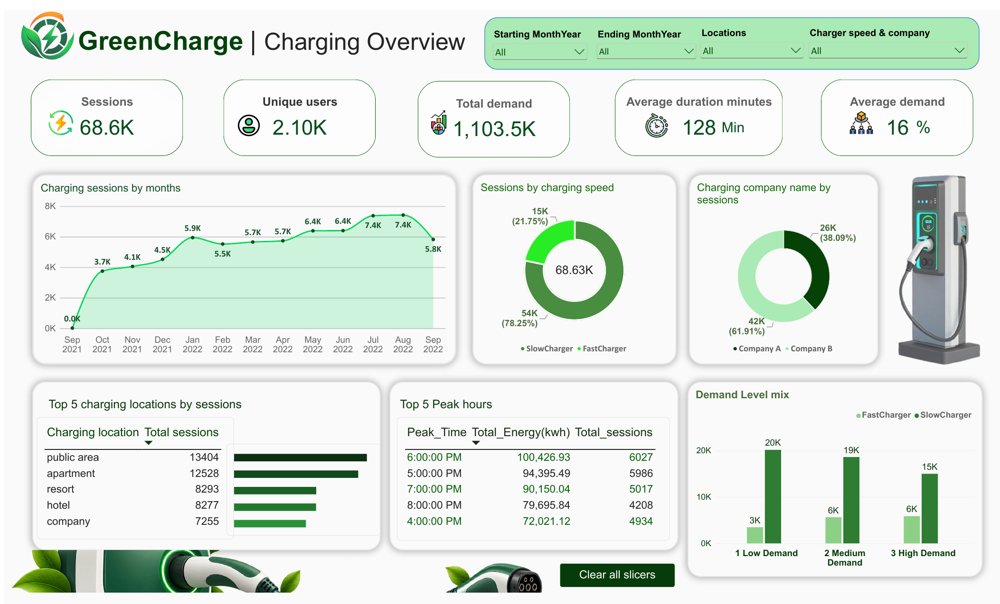

# GreenCharge Analytics | EV Charging Data Analytics

An end-to-end EV charging analytics case study using Python, Pandas, NumPy, SQL, and Power BI. The project explores charging-session activity, demand patterns, charger-speed usage, charging companies, locations, and operational insights.

## Project Overview

GreenCharge Analytics turns a cleaned EV charging dataset into an analysis-ready resource and an interactive Power BI dashboard. The workflow covers data preparation, exploratory data analysis, SQL exploration, visualization, and business insights.

## Objectives

- Prepare and validate EV charging session data.
- Explore charging behavior across time, locations, charger speeds, and companies.
- Identify peak charging periods and high-usage location categories.
- Present important metrics through an interactive Power BI dashboard.
- Document findings and recommendations for charging infrastructure planning.

## Project Workflow

1. **Data Cleaning (Python):** Clean and prepare the source dataset using Python, Pandas, and NumPy. Duplicate removal and outlier handling are part of the preprocessing workflow.
2. **Exploratory Data Analysis (EDA):** Explore distributions, charging patterns, session durations, demand, and categorical comparisons.
3. **SQL Analysis:** Use SQL queries for additional analytical exploration.
4. **Power BI Dashboard:** Build an interactive Charging Overview dashboard with filters for month range, locations, and charger speed/company.
5. **Business Insights:** Summarize findings, implications, recommendations, and limitations in `BUSINESS_INSIGHTS.txt`.

## Tools & Technologies

- Python
- Pandas
- NumPy
- Jupyter Notebook
- SQL
- Power BI

## Repository Contents

| File | Description |
|---|---|
| `ChargingRecords.csv` | Source charging records (review data permissions before public distribution) |
| `cleaned_data.csv` | Cleaned dataset used for analysis |
| `cleaned_data_with_outliers.csv` | Intermediate dataset retained from preprocessing |
| `flagged_records.csv` | Records flagged during data-quality checks |
| `outliers_data.csv` | Outlier records retained for review |
| `Python_cleaning.ipynb` | Python data-cleaning workflow |
| `EDA.ipynb` | Exploratory data analysis notebook |
| `Upload_Clean_Data.py` | Python utility/script for loading cleaned data |
| `Sql_queries.sql` | SQL analysis queries |
| `Dashboard.pbix` | Power BI dashboard file |
| `GreenCharge-Dashboard.png` | Dashboard preview image |
| `BUSINESS_INSIGHTS.txt` | Business insights and recommendations |

> Filenames above reflect the repository screenshot. If your GitHub filenames differ in capitalization or spelling, update this table to match exactly.

## Dashboard Preview

The dashboard includes:
- Charging sessions, unique users, total demand, average duration, and average demand KPIs
- Monthly charging-session trend
- Sessions by charging speed
- Sessions by charging company
- Top charging locations
- Peak charging hours
- Demand-level distribution
- Interactive slicers for month range, location, and charger speed/company

## Key Findings (Dashboard Snapshot)

- **Peak hour:** 6:00 PM with 6,027 sessions.
- **Next busiest hour:** 5:00 PM with 5,986 sessions.
- **Top location category:** Public area with 13,404 sessions.
- **Second location category:** Apartment with 12,528 sessions.
- **Charger mix:** Slow chargers account for 78.25% of sessions; fast chargers account for 21.75%.
- **Company share:** Company B accounts for 61.91% of sessions; Company A accounts for 38.09%.
- **Demand mix:** High-demand sessions contribute the largest share of total demand value.

For full metric definitions, detailed findings, recommendations, and limitations, see [`BUSINESS_INSIGHTS.txt`](BUSINESS_INSIGHTS.txt).

## Business Insights

The analysis points to concentrated evening charging activity, high session volumes at public-area and apartment locations, and a larger share of sessions on slow chargers. These patterns can inform capacity and utilization reviews. Company session share should not be interpreted as service quality or profitability without additional measures such as uptime, waiting time, reliability, and user satisfaction.

## How to View the Project

1. Clone or download this repository.
2. Open `EDA.ipynb` and `Python_cleaning.ipynb` to review the analysis workflow.
3. Open `Dashboard.pbix` in Power BI Desktop to explore the dashboard.
4. Read `BUSINESS_INSIGHTS.txt` for the complete insights report.

## Limitations

- Confirm the unit of `demand_value` from the dataset source before interpreting it as an energy unit such as kWh.
- Results are descriptive and do not establish causation.
- Company session share is not a direct performance or profitability measure.
- Month-to-month comparisons should account for date coverage and complete months.
- Operational recommendations should be validated with site capacity, uptime, queue, and local grid information.

## Author

**Kotra Shiva Kumar**  
GitHub: [kotrashivakumar1804](https://github.com/kotrashivakumar1804)  
LinkedIn: [Kotra Shiva Kumar](https://www.linkedin.com/in/kotra-shiva-kumar/)
